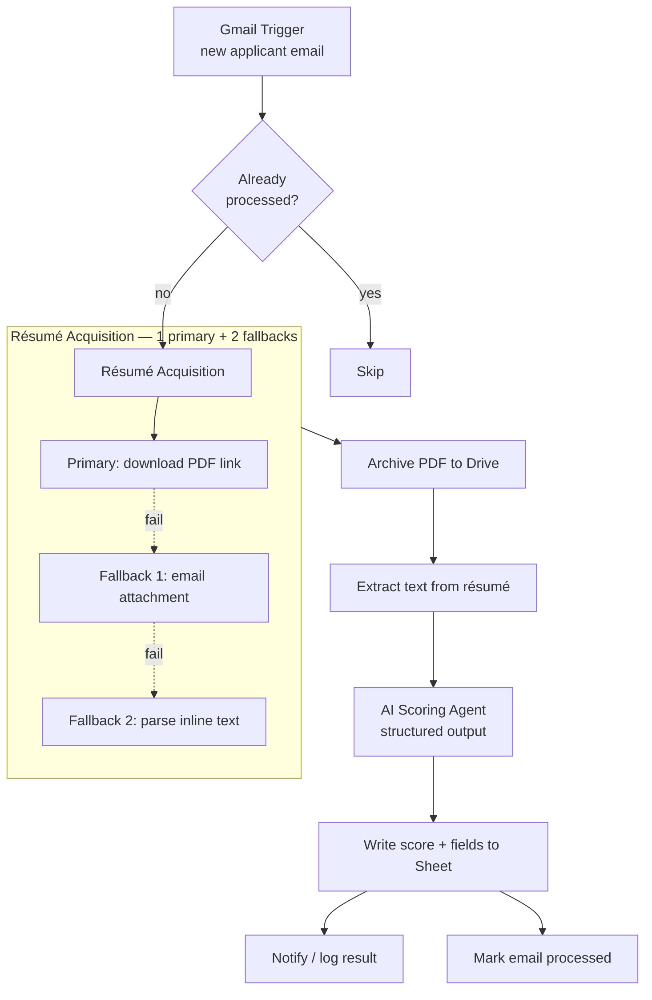

# AI Résumé Intake & Scoring — n8n Workflow

An end-to-end recruiting automation built in **n8n**. It watches an inbox for inbound applications
(e.g. Indeed), reliably retrieves each résumé through a primary path with two fallbacks, archives the
PDF, scores the candidate against role criteria with an AI agent, and logs the structured result —
then guards against ever processing the same application twice.

> **Demo project.** Sanitized export — all pinned candidate data, emails, phone numbers, file IDs,
> credentials, and company branding have been removed. Import it, connect your own accounts, and
> point it at your own inbox and sheet.

## What it does

1. **Trigger** — a Gmail trigger fires on new applicant emails.
2. **Dedupe guard** — checks a store so the same application is never scored twice.
3. **Résumé acquisition** — a primary path (download the résumé PDF) with **two fallbacks**
   (email attachment, then inline-text parse) so an application is almost never dropped.
4. **Archive & extract** — the PDF is saved to Drive and its text extracted.
5. **AI scoring** — an AI agent scores the candidate against the role's criteria and returns a
   strict structured result (fit score, strengths, gaps, recommendation).
6. **Log & notify** — the structured result is written to a Google Sheet and a notification is sent.

## Engineering highlights

- **Resilient acquisition** — one primary path + two fallbacks means résumés are captured even when
  the preferred source fails.
- **Idempotent** — a processed-email guard prevents duplicate scoring and duplicate notifications.
- **Structured AI output** — the scoring agent is constrained to a JSON schema, so results are
  consistent and directly writable to a sheet.
- **Document handling** — downloads, PDF archival, and text extraction wired into one flow.

## Tech stack

- **n8n** — Gmail trigger, HTTP, PDF/file handling, Code, AI Agent, Google Sheets/Drive
- **LLM** — AI agent for résumé scoring with a structured output parser
- 67 nodes across intake, acquisition, archival, scoring, logging, and notification

## How to use it

1. In n8n: **⋮ → Import from File** → select `workflow.json`.
2. Connect your own credentials: **Gmail**, **Google Sheets/Drive**, and your **LLM** provider.
3. Replace `YOUR_GOOGLE_FILE_ID` placeholders with your own sheet/folder IDs, and set the inbox
   filter and notification recipient.
4. Activate — or run a single email through it to test.

## License

MIT — see [../LICENSE](../LICENSE).
