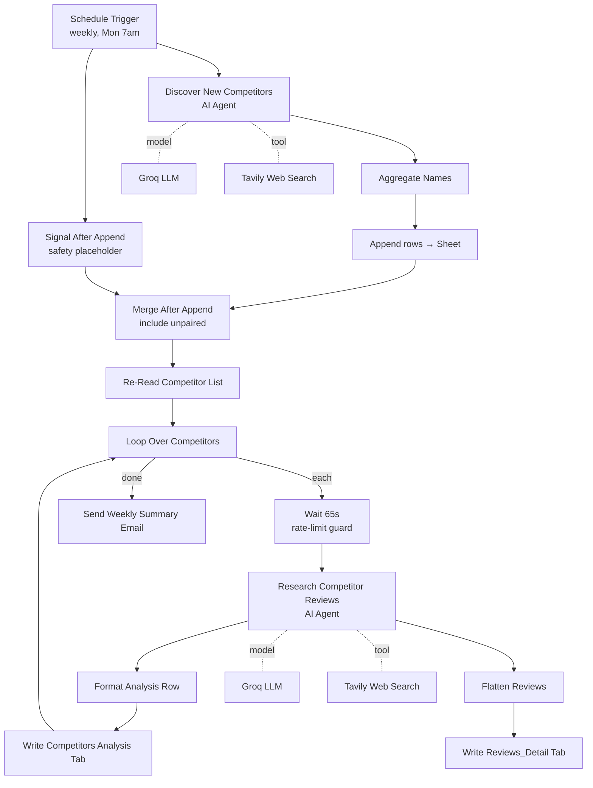

# AI Competitive Intelligence Research — n8n Workflow

A weekly, fully-automated competitive-intelligence pipeline built in **n8n**. Two AI agents work
together: one **discovers** new competitors on the web, the other **researches** each one for
reviews, pricing, address, and search-ranking visibility — then writes structured results into a
Google Sheet and emails a summary.

Runs entirely on **free-tier services**: Groq (LLM) + Tavily (web search).

> **Demo project.** This is a sanitized, generic version of a production workflow — company names,
> emails, sheet IDs, and credentials have been removed. Import it, connect your own accounts, and
> point it at your own sheet.

---

## What it does

Every Monday at 7am:

1. **Discovery** — an AI agent searches the web for competitors in a given market that aren't
   already tracked, and appends any real ones it finds to the sheet.
2. **Research** — for every tracked competitor (existing + newly found), a second AI agent runs up
   to 3 web searches and extracts: a company summary, confirmed address, review count & sentiment,
   praise/complaint themes with root-cause analysis, individual review snippets tagged by source,
   pricing & discount model, and SEO/GEO search-ranking visibility.
3. **Output** — results are written to two Google Sheet tabs (`Competitors Analysis`,
   `Reviews_Detail`) and a summary email is sent.

## Architecture

## Engineering highlights

- **Two cooperating AI agents** — a Discovery agent and a per-competitor Research agent, each with a
  structured-output parser forcing strict JSON (no free-form drift).
- **Anti-hallucination prompting** — the agents are instructed to report `"No review found"` /
  `"Not publicly available"` rather than invent reviews, prices, addresses, or rankings. Honest
  empty results are treated as valid.
- **Free-tier rate-limit handling** — searches are capped (max 2–3 per agent, lean payloads) to stay
  within Groq's tokens-per-minute budget, with a 65-second `Wait` between competitors.
- **The "always continue" fix** — n8n halts a branch that outputs zero rows, which would skip the
  whole research phase on weeks when Discovery finds nothing new. A parallel `Signal` item + a
  `Merge` with *include unpaired items* guarantees the pipeline always proceeds.
- **Idempotent writes** — the analysis tab is matched/updated by competitor name; the detail tab is
  refreshed per competitor instead of growing forever.

## Tech stack

- **n8n** — orchestration (Schedule Trigger, AI Agent, Loop, Merge, Code, Google Sheets, Gmail)
- **Groq** — free LLM (`openai/gpt-oss-120b`)
- **Tavily** — free web search API
- **Google Sheets** — structured data store
- **Gmail** — weekly notification

## How to use it

1. In n8n: **⋮ → Import from File** and select `workflow.json`.
2. Connect your own credentials on the four nodes that need them: **Groq**, **Tavily** (HTTP Header
   Auth), **Google Sheets**, and **Gmail**.
3. Replace `YOUR_GOOGLE_SHEET_ID` on the Google Sheets nodes with your sheet, and set the recipient
   on the email node.
4. Create the two tabs (`Competitors Analysis`, `Reviews_Detail`) with matching column headers.
5. Activate — it runs weekly, or hit **Execute** to test.

## License

MIT — see [LICENSE](LICENSE).
