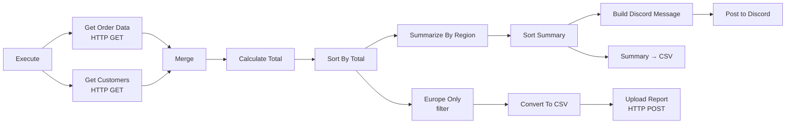

# Order Reporting Pipeline — n8n Workflow

A data-processing and reporting workflow built in **n8n**. It pulls orders and customers from an
API, joins and enriches them, computes totals, summarizes by region, filters a segment, and delivers
the results to multiple destinations (CSV, Discord, and an upload endpoint).

> **Demo project.** Sanitized export — credentials removed. Import it, connect your own accounts, and
> point the HTTP nodes at your own data source.

## What it does

1. **Fetch** — orders and customers are pulled in parallel from two HTTP endpoints.
2. **Merge & enrich** — the two sources are combined, then a total is calculated per order.
3. **Sort & summarize** — orders are sorted by value, then aggregated into a per-region summary.
4. **Branch & deliver** — the summary is posted to **Discord** and exported to **CSV**, while a
   Europe-only slice is converted to CSV and uploaded to a reporting endpoint.

## Skills shown

- Parallel HTTP fetches merged into one dataset
- Field transformation and calculated fields
- Sorting, grouping/aggregation, and filtering
- Format conversion (JSON → CSV)
- Fan-out to multiple destinations (chat notification + file upload)

## Tech stack

- **n8n** — HTTP Request, Merge, Set/Edit Fields, Sort, Summarize, Filter, Convert to File, Discord
- Works with any JSON order/customer API (originally built against the n8n Quickstart sample data)

## How to use it

1. In n8n: **⋮ → Import from File** → select `workflow.json`.
2. Point **Get Order Data** and **Get Customers** at your own endpoints (and set HTTP auth if needed).
3. Connect a **Discord** webhook credential on the Discord node, and set the **Upload Report**
   destination.
4. Click **Execute** to run.

## License

MIT — see [../LICENSE](../LICENSE).
