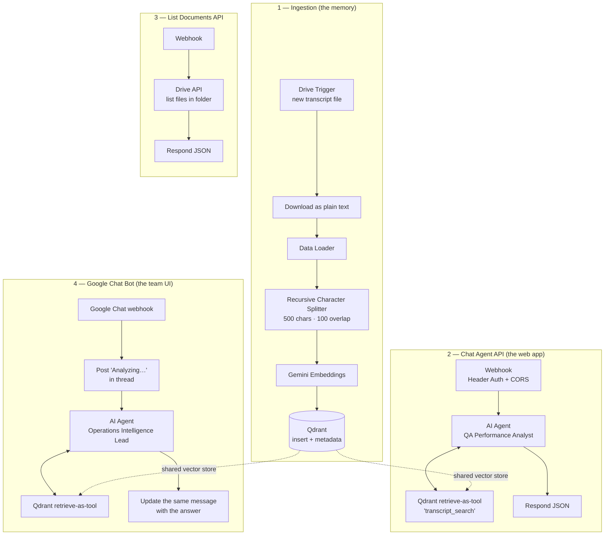

# RAG Transcript Assistant — n8n Workflow System

A four-part **Retrieval-Augmented Generation** system built in n8n. It turns a folder of call
transcripts into a searchable knowledge base, then lets your team ask questions about it in plain
language — from a web app or from Google Chat — with answers grounded in the actual transcripts
instead of invented.

> **Demo project.** Sanitized export — company names, Drive folder IDs, GCP project IDs, employee
> names, credentials, and webhook IDs have all been removed. Import it, connect your own accounts,
> and point it at your own folder.

## The problem it solves

Sales and service calls get transcribed, and then the transcripts sit in a folder nobody reads.
The information is technically "stored," but practically inaccessible — finding out whether three
different customers complained about the same thing means opening thirty documents.

Asking a general-purpose chatbot doesn't work either: it has never seen your transcripts, and if you
paste them in, you hit context limits and it starts making things up.

RAG fixes this. Transcripts are chunked, converted into vectors, and stored in a vector database.
When someone asks a question, the system retrieves only the handful of genuinely relevant chunks and
hands those to the model as context — so answers are grounded in real source material, and the model
can cite which file it came from.

## Architecture

**Workflow 1 builds the memory. Workflows 2–4 read from it.** That separation is the point — you can
add new query surfaces (Slack, a different app, a voice bot) without touching ingestion, and you can
reindex everything without taking the chat interfaces down.

---

## The four workflows

### 1. Ingestion — [`1-ingestion.json`](1-ingestion.json)

Watches a Google Drive folder. When a transcript lands:

1. **Downloads and converts to plain text** — Google Docs are converted to `text/plain` so the model
   reads clean text rather than document markup.
2. **Chunks it** — recursive character splitter, ~500 characters with **100 characters of overlap**.
   The overlap matters: without it, a sentence split across a chunk boundary becomes unfindable.
3. **Embeds and stores** — Gemini embeddings into a Qdrant collection.
4. **Tags each chunk with metadata** — `source_link`, `file_name`, and `agent_name` (parsed from the
   filename). This is what makes answers *citable* — the agent can tell you which call it came from
   and give you a link, rather than asserting something with no traceable source.

### 2. Chat Agent API — [`2-chat-agent.json`](2-chat-agent.json)

A secured HTTP endpoint for a front-end app to call.

- **Webhook with Header Auth** and a CORS allow-list, so the endpoint isn't open to the internet.
- **AI Agent** prompted as a QA Performance Analyst, with the vector store attached as a tool named
  `transcript_search`.
- **Forced retrieval** — the system prompt requires the agent to call the search tool before
  answering, and to say so when nothing relevant is found. This is the main guard against the
  failure mode where a RAG agent skips retrieval and answers from the base model's general knowledge.
- Returns clean JSON: `{ "output": "..." }`.

### 3. List Documents API — [`3-list-documents-api.json`](3-list-documents-api.json)

A small supporting endpoint. Returns the files currently in the watched folder as JSON
(`name`, `id`, `link`) so the front end can show users what the assistant actually knows about.

Small, but it closes a real UX gap: without it, users can't tell the difference between "the
assistant doesn't know" and "that document was never ingested."

### 4. Google Chat Bot — [`4-google-chat-bot.json`](4-google-chat-bot.json)

The same knowledge base, exposed where the team already works.

- Receives messages from a Google Chat space.
- **Immediately posts a "Analyzing…" placeholder**, then **edits that same message** with the final
  answer. Retrieval plus generation takes several seconds, and a bot that sits silent reads as
  broken — this gives instant feedback without cluttering the thread with two messages.
- **Threads replies** so a conversation stays readable in a busy space.
- Prompted as an operations analyst: detect patterns across multiple transcripts, identify root
  cause, flag risks, cite the source file, and say so when the retrieved context doesn't answer the
  question.

---

## Engineering highlights

- **Separation of ingestion and retrieval** — one writer, three readers, one shared vector store.
- **Chunk overlap** — 100 characters, so detail spanning a boundary stays retrievable.
- **Metadata on every chunk** — answers are traceable back to a source file and link.
- **Grounding rules in the prompt** — retrieval is mandatory and "I don't know" is an allowed answer.
- **Secured webhooks** — Header Auth plus CORS origin allow-listing on public endpoints.
- **Responsive async UX** — placeholder-then-edit pattern for a multi-second AI response.
- **Swappable surfaces** — adding Slack or a voice interface means adding a reader, not a rewrite.

## Tech stack

| Layer | Tool |
|---|---|
| Orchestration | n8n |
| Vector database | Qdrant |
| Embeddings | Google Gemini (`gemini-embedding-001`) |
| LLM | Google Vertex AI |
| Document source | Google Drive |
| Interfaces | HTTP webhook (web app) + Google Chat |

## How to use it

1. In n8n: **⋮ → Import from File** → import all four JSON files.
2. Create a **Qdrant** collection and connect your Qdrant credential on each vector-store node.
3. Connect **Google Drive**, **Google Gemini**, and **Google Vertex AI** credentials.
4. Replace `YOUR_DRIVE_FOLDER_ID` in workflow 1 and 3 with your own folder ID, and
   `your-gcp-project-id` in workflows 2 and 4 with your GCP project.
5. Create a **Header Auth** credential for the webhooks in workflows 2 and 3, and set
   `allowedOrigins` to your own app's domain.
6. For workflow 4, configure a Google Chat app pointed at that workflow's webhook URL.
7. Activate workflow 1 and drop a transcript into the folder to build the index, then query it
   through workflow 2 or 4.

> **Note on costs:** embeddings are charged per token ingested, and the LLM per query. Indexing a
> large back-catalogue of transcripts is a one-off cost worth estimating before you point this at
> thousands of files.

## License

MIT — see [../LICENSE](../LICENSE).
